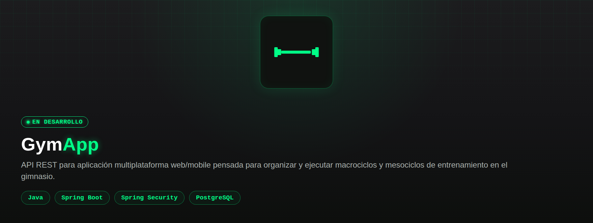
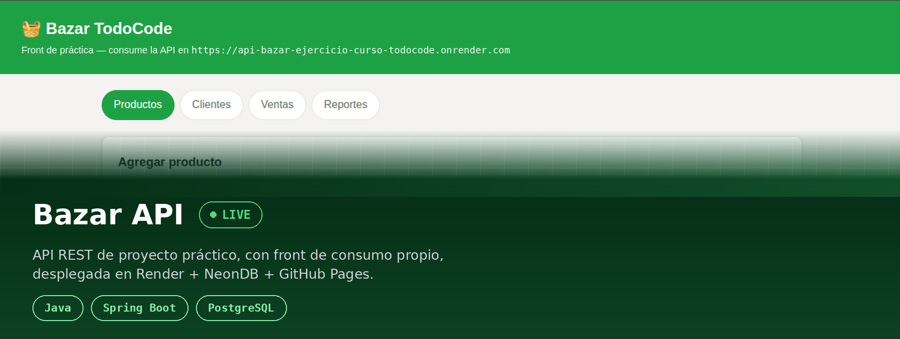
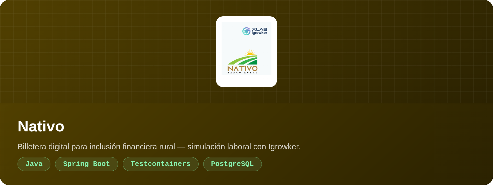
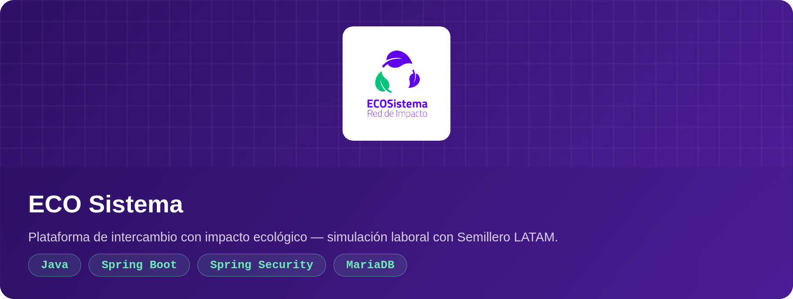
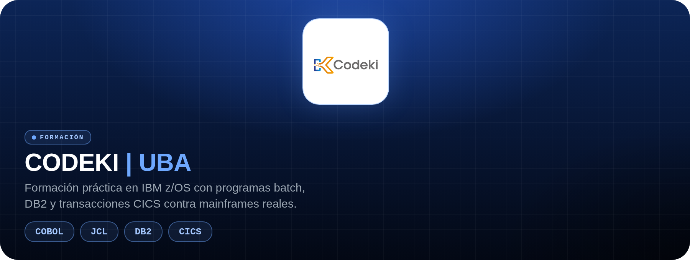
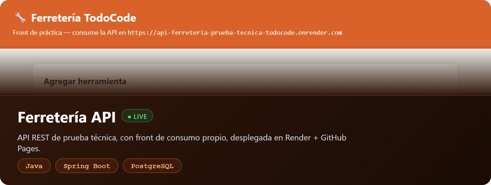
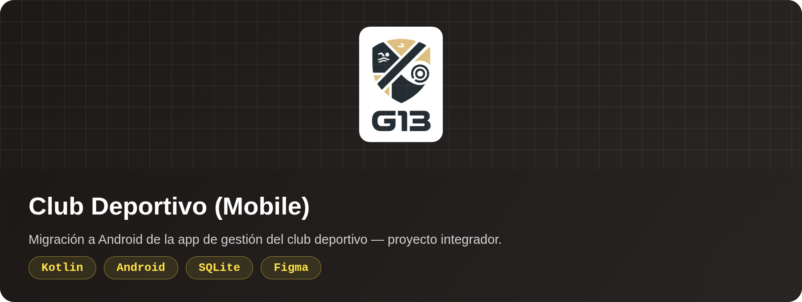
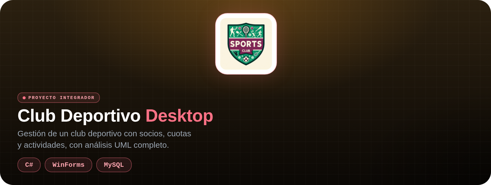

  

    &lt;/&gt; MDEV
  

  

  ### 👋 ¡Hola! Soy **Matías** | Hello there! I'm **Matías**

  

  
  
  

 

## 🔍 Acerca de mí | About Me

  

    Desarrollador de software enfocado en backend dentro del ecosistema <strong>Java + Spring Boot</strong>. Estoy terminando la Tecnicatura en
    Desarrollo de Software (5 materias restantes) y sumando, en paralelo, un roadmap propio de especialización backend con Java (microservicios con Spring Cloud, Spring Security, testing, Spring AI, y mucho más!).
  

  

    Mi diferencial no es solo saber programar. En mis proyectos de la carrera llevo adelante procesos completos de <strong>análisis y diseño</strong> (relevamiento de requerimientos, DFD, diagramas de casos de uso, modelado de datos) antes de escribir una sola línea de código - algo poco habitual en un perfil con mi experiencia, que suele arrancar directo en la etapa de desarrollo.
  

  

    A eso sumo formación y práctica real en <strong>Mainframe IBM</strong> (COBOL, JCL, DB2, CICS), completada en 7 meses de trabajo intensivo con los profesionales de CODEKI | UBA contra mainframes reales 24/7. Es una combinación poco común que me permite entender tanto sistemas backend modernos como legacy/transaccionales.
  

  

    Todavía no tengo experiencia laboral formal, así que construyo evidencia práctica: proyectos propios
    documentados de punta a punta (análisis, diseño, código, tests, deploy) y desarrollos freelance para terceros.
  

  

  

    Software developer focused on backend within the <strong>Java + Spring Boot</strong> ecosystem. I'm finishing my Software Development degree
    (5 courses left) while following my own backend specialization roadmap with Java (microservices with Spring Cloud, Spring Security, testing, Spring AI, and much more!).
  

  

    My differentiator isn't just knowing how to code: in my degree projects I carry out full <strong>analysis and design</strong> processes (requirements gathering, DFDs, use case diagrams, data modeling) before writing a single line of code — something uncommon for a Trainee/Jr profile, which usually starts straight at the development stage.
  

  

    On top of that, I have real training and hands-on practice in <strong>IBM Mainframe</strong> (COBOL, JCL,
    DB2, CICS), completed over 7 months of intensive work with the professionals at CODEKI | UBA against real 24/7 mainframes. It's an uncommon combination that
    helps me understand both modern and legacy/transactional backend systems.
  

  

    I don't have formal work experience yet, so I build practical evidence instead: fully documented personal
    projects (analysis, design, code, tests, deploy) and freelance work for third parties.
  

 

  ## 🔥 Stack

  <h4><strong>[ Backend ] [ Java ]</strong></h4>

 

  <h4><strong>[ Mainframe ] [ IBM ]</strong></h4>

  <h4><strong>[ Herramientas ]</strong></h4>

 

<strong>🧩 Otras tecnologías | Other technologies</strong>

 

 

 

 

 

## 🚀 Proyecto Actual | Current Project

> En desarrollo, aplicando lo último que sumé a mi roadmap (Spring Security). Va a ser mi primera aplicación real pensada para llegar a producción y uso público, no un ejercicio de práctica.

API REST para aplicación multiplataforma web/mobile pensada para organizar y ejecutar
macrociclos y mesociclos de entrenamiento en el gimnasio. Sin repositorio público todavía.

 

> Mientras tanto, el proyecto con código visible que mejor refleja mi nivel actual es **Bazar**. Cada tecnología nueva que incorporo a mi roadmap (programación funcional → microservicios | Spring Cloud → Spring Security → testing → Spring AI) se documenta acá como una iteración real, en vez de quedar dispersa en mini-proyectos sueltos.

API REST para la gestión de ventas de un bazar: productos, clientes y ventas relacionados
entre sí, con reportes de negocio (bajo stock, monto vendido por fecha, venta más alta).
El modelado agrega una entidad `SaleItem` no pedida por la consigna, necesaria para
resolver correctamente la relación muchos-a-muchos entre venta y producto con datos
propios (cantidad, precio unitario, subtotal).

Construido con **Java 25 + Spring Boot 4**, arquitectura en capas (Controller → Service
→ Repository) con **DTOs + Mapper**, manejo centralizado de excepciones (`ProblemDetail`
/ RFC 7807), y refactor completo a **programación funcional** (Streams). Dockerizado
(`Dockerfile` + `docker-compose.yml`) y deployado de punta a punta: backend en Render,
base de datos en Neon (PostgreSQL), front propio consumiéndolo en vivo desde GitHub Pages.

 

## 💼 Proyectos Destacados | Featured Projects

Serie de proyectos que demuestran mis habilidades técnicas y blandas para el desarrollo de software de calidad.

 

 

 

## 🖥️ Mainframe

El proyecto que demuestra mi diferencial con tecnologías IBM Mainframe.

 

<strong>📚 Proyectos Formativos | Academic Projects</strong>

 

 

 

 

## 📊 Actividad

  

<h2><strong>🤝 Contacto | Contact</strong></h2>

<em>🔎 Buscando oportunidades como Backend Developer (Java) | COBOL Developer — primer empleo formal en desarrollo.</em>

<em>🔎 Looking for Backend Developer (Java) | COBOL Developer opportunities — first formal role in software development.</em>

