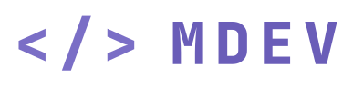
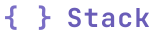
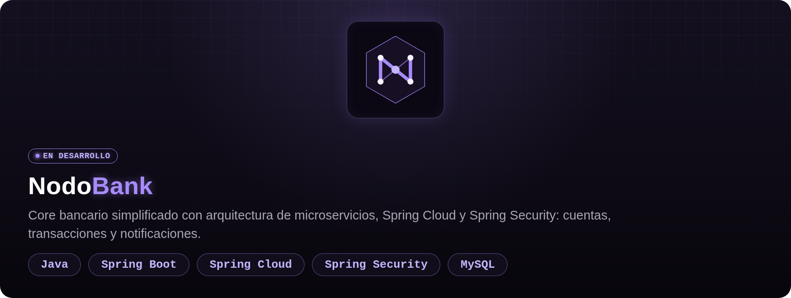
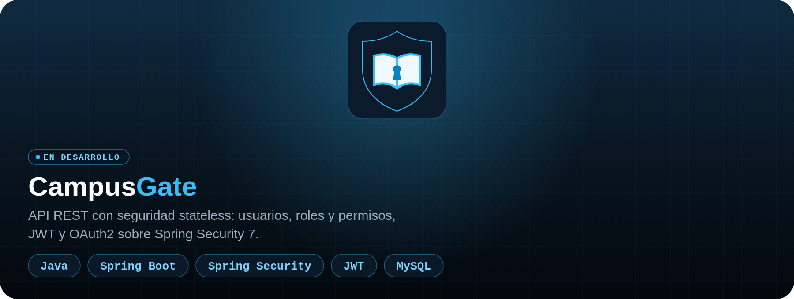
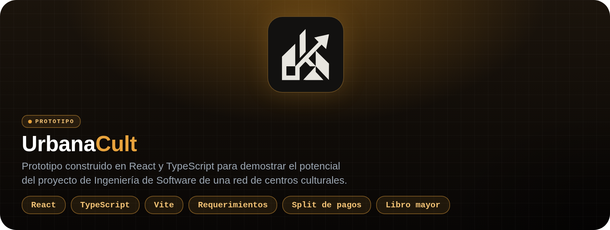
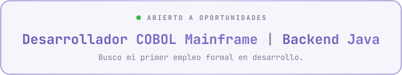

  

  

  ### ¡Hola! Soy **Matías** 👋

  

  &nbsp;&nbsp;&nbsp;&nbsp;
  
  

 

## 

Soy desarrollador de software, enfocado en el backend y el diseño de soluciones. Trabajo sobre todo con Java y Spring Boot, y además hice una formación intensiva de Mainframe IBM en CODEKI | UBA, utilizando COBOL, JCL, DB2 y CICS sobre equipos reales. Hoy desarrollo junto con la IA como herramienta, pero el diseño y las decisiones son mías.

Estoy terminando la Tecnicatura en Desarrollo de Software, me faltan cinco materias, y todavía no tengo experiencia laboral formal, así que lo que puedo mostrar es lo que construí. Busco mi primera oportunidad, tanto en equipos de Java como de Mainframe.

<b>Ver más sobre cómo trabajo</b>

 

Lo que más me gusta es entender qué necesita un cliente, pensar cómo resolverlo y construirlo hasta que funcione. Eso es lo que muestran los proyectos de abajo. [CampusGate](https://mdev-repos.github.io/front_campusgate__proyecto_demostracion/), por ejemplo, es una API con seguridad real que está publicada, y se puede probar desde el navegador sin instalar nada. [Urbana Cult](https://mdev-repos.github.io/prototipo_urbana_cult_proyecto_tecnicatura/), el proyecto final de Ingeniería de Software que hicimos en equipo, me sirvió para mostrar la otra mitad, la que va antes del código. Partimos de un caso de negocio, una red de centros culturales que necesitaba repartir automáticamente cada cobro entre el centro, el artista y la red, y yo me concentré en el split de pagos, desde los requerimientos hasta un prototipo que se puede recorrer en el navegador.

Y la verdad es que me divierte desarrollar. Cuando no estoy con un proyecto personal, de la facultad o freelance, sigo aprendiendo cosas por gusto. Ahora, por ejemplo, estoy haciendo un videojuego con Java y LibGDX, que no me lo pide ningún trabajo y aun así me engancha.

 

  ## 

Las tecnologías que uso en mis proyectos, organizadas por área.

  <h4><strong>[ Backend ] [ Java ]</strong></h4>

 

 

  <h4><strong>[ Frontend ] [ Web ]</strong></h4>

  <h4><strong>[ Mainframe ] [ IBM ]</strong></h4>

 

  <h4><strong>[ Análisis y diseño ]</strong></h4>

 

  <h4><strong>[ Herramientas y despliegue ]</strong></h4>

 

 

## 

Proyectos propios que estoy construyendo en este momento.

 

  

 

[Ver más sobre el diseño](https://github.com/mdev-repos/microservicios_nodobank__proyecto_demostracion#readme)

NodoBank se encuentra en desarrollo. Es la versión con dominio propio del proyecto final del curso de Microservicios con Spring Cloud de TodoCode Academy, y elegí el dominio bancario a propósito, porque obliga a pensar en integridad de datos, concurrencia y trazabilidad.

Es un core bancario simplificado, con cuentas, transacciones (depósitos, retiros y transferencias) y aviso por email de cada operación confirmada. Lo armo como un monorepo de microservicios con Java 25, Spring Boot 4 y Spring Cloud. Hoy están terminados Eureka Server, Config Server y accounts-sv, y estoy trabajando en transactions-sv. Lo que sigue es la seguridad con Spring Security y JWT, las notificaciones, el API Gateway, Docker y los tests.

Además, estoy aprendiendo Go para reescribir en ese lenguaje el servicio que más tráfico recibe y comunicarlo con los servicios en Java mediante gRPC, midiendo con métricas y pruebas de carga qué cambia en rendimiento. Antes de seguir, estoy escribiendo el documento de diseño y arquitectura que fija cómo queda el sistema completo.

 

  

 

  

 

"GymApp" se encuentra en fase de diseño. Va a ser mi primera aplicación personal real, pensada para llegar a producción y uso público, y no es un ejercicio de práctica ni un trabajo freelance.

Nace de mi propio proceso de cambio fisico entrenando con planillas de papel. Será una aplicación instalable en el celular que reproduce ese seguimiento para que otros puedan lograrlo. Planificar macrociclos y mesociclos, entrenar ejercicio por ejercicio con descansos y cronómetro, y comparar cada serie con la de la vez anterior. Funciona también sin conexión en el gimnasio, y más adelante sumará control de peso, medidas y nutrición. Va acompañada de una landing con mi historia y recomendaciones de profesionales para aprender a entrenar.

La estoy diseñando y construyendo junto con un agente de IA, como práctica de trabajar con documentación clara, decisiones registradas, pruebas e integración continua desde el primer día. La parte de servidor va con Java, Spring Boot y PostgreSQL. Todavía no tiene repositorio público, lo voy a abrir cuando haya una primera versión que se pueda desplegar.

 

## 

Mi formación práctica en IBM z/OS: COBOL, JCL, DB2 y CICS.

  

 

[Ver más sobre el contenido](https://github.com/mdev-repos/formacion_desarrollador_cobol_mainframe__codeki_uba#readme)

Siete meses de formación práctica intensiva con CODEKI | UBA, trabajando contra mainframes reales (TSO/ISPF sobre terminal 3270). El repositorio reúne 23 programas en tres etapas. Primero COBOL batch, con cortes de control, apareo de archivos, tablas, VSAM/QSAM y reportes. Después COBOL con DB2, con SQL embebido, cursores, INSERT y UPDATE. Y por último transacciones CICS, con mapas BMS, COMMAREA y menús. Todo con sus JCL, copybooks y capturas del entorno.

 

## 

Serie de proyectos que demuestran mis habilidades técnicas y blandas para el desarrollo de software de calidad.

 

  

 

[Ver más sobre el diseño](https://github.com/mdev-repos/security_campusgate__proyecto_demostracion#readme)

CampusGate está publicada y se puede probar desde el navegador, sin instalar nada. Es una API REST de una plataforma educativa, con alumnos, profesores y cursos, donde lo central es la seguridad. Los usuarios, los roles y los permisos están modelados desde cero, la autenticación es stateless con JWT y la autorización combina permisos con reglas de pertenencia, por ejemplo que un profesor edite solo sus propios cursos.

La construí con Java 25, Spring Boot 4 y Spring Security 7, y la acompaña un front en React y TypeScript con tres cuentas de ejemplo, un inspector del token y un laboratorio que lanza a propósito requests prohibidos para ver cómo responde la API.

 

  

 

  

 

[Ver más sobre el diseño](https://github.com/mdev-repos/prototipo_urbana_cult_proyecto_tecnicatura#readme)

Urbana Cult fue el proyecto final de Ingeniería de Software de la tecnicatura, trabajado en equipo. Parte de un caso de negocio, una red de 25 centros culturales independientes que necesita una cartelera única, venta de entradas sin sobreventa y un reparto automático de cada cobro entre el centro, el artista y la red. El prototipo recorre de punta a punta cómo se mueve el dinero de una entrada, desde la compra hasta la liquidación a los dos días, con seis roles y un panel para cada uno.

Mi foco estuvo en el split de pagos. En el prototipo el dinero se maneja en centavos enteros, el libro mayor no se edita, y las devoluciones agregan asientos de reversión en vez de modificar los anteriores. Las reglas de negocio viven en funciones puras, separadas de las pantallas. El trabajo incluye además la documentación del proyecto, con 43 requerimientos funcionales y 18 no funcionales identificados, y diez de ellos especificados en detalle.

 

  

 

  

 

[Ver más sobre el diseño](https://github.com/mdev-repos/api_nativo_banco_rural__proyecto_igrowker#readme)

Nativo fue una simulación laboral con Igrowker, de España. Es una billetera digital para inclusión financiera rural, con pagos por QR, microcréditos entre pares y donaciones. Fue mi segunda experiencia colaborativa, en un equipo grande con roles definidos (UX/UI, Frontend, Backend y QA) y trabajo bajo SCRUM y Kanban.

Mi aporte fue el módulo de pagos con QR, desde la generación del código con ZXing hasta el ciclo completo del pago, con un QR válido por 10 minutos, validación de fondos y actualización de saldos. El repositorio incluye tests unitarios y de integración con Testcontainers.

 

  

 

<b>Proyectos formativos</b>

 

  

 

[Ver más sobre el diseño](https://github.com/mdev-repos/api_bazar__ejercicio_curso_todocode#readme)

API REST para la gestión de ventas de un bazar, con productos, clientes y ventas relacionados entre sí y reportes de negocio como el bajo stock, el monto vendido por fecha y la venta más alta. Nació de un ejercicio práctico de TodoCode Academy y lo llevé más lejos de lo pedido. Agregué una entidad SaleItem que la consigna no pedía, necesaria para resolver bien la relación muchos a muchos entre venta y producto con datos propios, como la cantidad, el precio unitario y el subtotal.

La armé con Java 25 y Spring Boot 4, con arquitectura en capas, DTOs y mappers, errores centralizados con ProblemDetail y un refactor completo a programación funcional con Streams. Está dockerizada y desplegada de punta a punta, con el backend en Render, la base de datos en Neon y un front propio en GitHub Pages que la consume en vivo.

 

  

 

  

 

[Ver más sobre el diseño](https://github.com/mdev-repos/api_ecosistema__proyecto_semillero_latam#readme)

Simulación laboral de Semillero LATAM (Quinto Impacto, Mendoza), una plataforma que conecta proveedores con impacto ambiental positivo con consumidores. Fue mi primera experiencia de desarrollo colaborativo, bajo SCRUM y Trello, y terminé ejerciendo como referente informal del equipo de backend.

Mi aporte fue el sistema de emails semanales automáticos para administradores y proveedores, con Spring Mail y Thymeleaf, que investigué e implementé a partir de la documentación. El stack incluye Java, Spring Boot, MariaDB, JWT y Google OAuth2.

 

  

 

  

 

[Ver más sobre el diseño](https://github.com/mdev-repos/api_ferreteria__prueba_tecnica_todocode#readme)

API REST de gestión de una ferretería, una prueba técnica de TodoCode Academy, hecha con Spring Boot, JPA, DTOs y manejo centralizado de errores con ProblemDetail. Está dockerizada para correrla en local con Docker Compose, y tiene una herramienta web con un semáforo que avisa cuándo la API ya está lista, para probarla desde el navegador.

 

  

 

  

 

[Ver más sobre el diseño](https://github.com/mdev-repos/desktop_app_clinica_seprise__proyecto_tecnicatura#readme)

Sistema de gestión de consultorios médicos, con turnos, historia clínica, insumos y liquidación de honorarios, hecho en C#/.NET junto a un compañero después de un ciclo completo de análisis y diseño. Tiene arquitectura en capas (entidades, repository, service y vistas), dos roles con su propio dashboard, reglas de negocio por especialidad, una máquina de estados para los turnos y comprobantes en PDF. La persistencia es simulada en memoria, y el README explica por qué.

 

  

 

  

 

[Ver más sobre el diseño](https://github.com/mdev-repos/desktop_app_club_deportivo__proyecto_tecnicatura#readme)

Sistema de gestión de un club deportivo, con socios, cuotas y actividades, hecho en C#/.NET con MySQL y Stored Procedures. Cuenta con análisis UML completo, comprobantes en PDF y manual de usuario.

 

  

 

  

 

[Ver más sobre el diseño](https://github.com/mdev-repos/mobile_app_club_deportivo__proyecto_tecnicatura#readme)

Migración a Android con Kotlin del sistema de escritorio del club, repensada para uso mobile. Usa una base SQLite local, navegación por Activities y un diseño previo en Figma, pantalla por pantalla.

 

## 

  

## 

&nbsp;&nbsp;&nbsp;&nbsp;
&nbsp;&nbsp;&nbsp;&nbsp;

  

